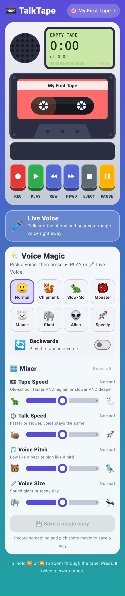

# 📼 TalkTape

A pocket tape recorder for kids, inspired by the classic 90s handheld voice recorders, with a few superpowers they never had. Native Android (Kotlin + Jetpack Compose), works fully offline, no ads, no accounts, no internet permission.



## What it does

**The classic tape deck**
- Big chunky piano keys: **REC, PLAY, REW, F.FWD, STOP/EJECT, PAUSE**. Latched keys stay pushed down like a real deck.
- **Hold ⏪ / ⏩** to zoom through the tape with the squeaky fast-wind sound; tap them to jump 5 seconds.
- Records *over* the tape from where you are, like a real cassette (it asks first, and offers a new tape instead).
- **Tape Speed** knob: the original slow-mo trick. Faster = higher and quicker, slower = deeper and slower.
- **Live Voice**: talk into the phone and hear yourself through the speaker, with all the voice magic, live (megaphone mode). Warns about feedback squeal if no headphones are plugged in.
- Spinning reels, a tape that moves from one reel to the other, an LCD counter, a level meter, and speaker holes that bounce with the sound.
- Up to 5 minutes per tape.

**The superpowers**
- **Voice Pitch**: higher or lower (±12 semitones) *without* changing speed, and the voice keeps its natural "size".
- **Voice Size** (formants): sound like a giant or something teeny-tiny, without changing pitch.
- **Talk Speed**: faster or slower (0.5×–2×) *without* changing the pitch.
- **Backwards** playback, combinable with everything else.
- 8 one-tap voices: Normal, Chipmunk, Slow-Mo, Monster, Mouse, Giant, Alien, Speedy.
- All knobs work *while the tape is playing*.
- **Save a magic copy** bakes the current effect into a new tape.

**More magic** (Easy view: presets and one knob per effect; Studio view: every engineer's knob):
- **Auto-Tune**: Smooth (keeps your vibrato) or Robot, any of 7 scales in any key, **Find my key** listens to the tape; Studio: retune speed, keep vibrato, strength, flex.
- **Harmony**: up to 3 backing singers that follow you in key (3rd, 5th, chord, octaves, choir), each a slightly different person.
- **Talk-box**: your words on a synth (Robot note, Synth melody, Chord, Bass), consonants kept clear.
- **Whisper**, **Places** (phone, walkie-talkie with squelch + roger beep, old radio, megaphone, underwater), **Old Tape**, **Wobble** (tremolo, vibrato, jet flanger, phaser).
- **Room**: twin voices, echo, reverb. **Ghost Swell**: reverse reverb that rises before each word. **Fly-Around**: binaural circle / side to side / zoom past (Doppler) / overhead.
- **Auto Stutter** ("h-h-hello"), **Hold to Freeze**, **Hold to Stutter**, and **scratch** by dragging the cassette.
- **Clean-up**: spectral noise reduction (Wiener, whole-tape noise profile) + vocal channel strip (low cut, de-esser, compressor, presence/air, auto-level, limiter).
- 35 presets in 5 rows: Funny voices, Music & robots, Places, Spooky & wild, Studio.
- **A/B loop** with click-free wrap, zoomable waveform, mini deck that stays on screen.

**My Tapes**: any number of tapes with names and colour labels; rename, share (as a WAV), or throw away (with a confirm). Press STOP when stopped (it becomes EJECT) to open the tape box.

## How the sound works

Pure Kotlin, no native code, in `audio/`: `Spectral.kt` (vocoder, noise reduction, talk-box carrier), `Voices.kt` (lead + harmony engine), `Tuning.kt` (auto-tune, key finder), `Render.kt` (playhead, signal chain), `Character.kt`, `Spatial.kt`, `Polish.kt`, `Space.kt`, `Performance.kt`:

- A streaming **phase vocoder** (2048-point FFT, 4× overlap) does Talk Speed and pitch shift. Peaks move as whole regions with their phases locked together (Laroche-Dolson), and phases reset on sudden onsets so consonants stay crisp.
- The voice shape is a **true envelope** (iterated cepstrum) whose detail follows the voice's own pitch (YIN detector): sharp enough to keep the vowel's formants apart, never sharp enough to trace the harmonics. Pitch divides it out and puts it back (voice keeps its vowels); Voice Size stretches it, which moves the formants instead of just tilting the treble.
- **Auto-Tune** uses the same pitch detector: Smooth glides onto the nearest note (70 ms), Robot snaps instantly; pick any note or a major key.
- **Twin Voices**: up to 4 copies, each a few cents out of tune (two-tap rotating delay), 19–43 ms late and drifting, panned left/right.
- **Echo**: stereo ping-pong with darkening repeats. **Reverb**: 8-line feedback delay network with diffusers, damping and modulation; one knob grows room size, decay and level together.
- A limiter at the end means stacked effects never clip. Tape Speed and Backwards are just how the playhead reads the tape (Hermite interpolation), so they skip the vocoder entirely.
- **Mono or stereo**: new tapes record in either (stereo uses the phone's mic pair); playback is stereo or both-speakers mono.
- With every knob at Normal it is bit-transparent; checks in `app/src/test` cover formant placement, auto-tune, echo timing, reverb tail, layer loudness, clipping and speed.

On a Galaxy S22 Ultra a stereo tape with the heaviest preset uses about half of one core (each play logs `dsp load` to logcat under `TalkTape`).

To hear the voices on a PC: `TALKTAPE_SAMPLE=<mono 44.1 kHz wav> ./gradlew :app:testDebugUnitTest --tests '*DemoRender*'` writes one wav per voice next to it.

## Build

Needs JDK 17+ and the Android SDK (API 36).

```bash
cd talkboy
./gradlew :app:testDebugUnitTest   # voice-effect checks + renders the screen to app/build/screenshots
./gradlew :app:assembleDebug       # app/build/outputs/apk/debug/app-debug.apk
```

CI (`.github/workflows/talktape.yml`) builds both APKs and the screenshots on every change under `talkboy/`; grab them from the run's artifacts.

The release build is signed with the debug key so it installs straight away. Add a real keystore before publishing to Google Play.
